<picture><source media="(prefers-color-scheme: light)" srcset="assets/light/hero.svg" /></picture>

  <b>Hi, I'm Brian</b>, aka <b>Atlas</b>. I'm a <b>Computational Biomedicine &amp; AI</b> student at <b>Universidade Lusófona</b> in Lisbon. 
  I'm interested in the place where medicine and machine learning meet: models that learn from slides, signals and sensors.

  NOW BUILDING&nbsp;&nbsp;→&nbsp;&nbsp;<b><a href="https://github.com/BrianFFranck/IRIS">IRIS</a></b>, an AI that grades prostate biopsies and shows where it looked: a second reader for every prostate biopsy.

 

<a href="https://github.com/BrianFFranck/IRIS"><picture><source media="(prefers-color-scheme: light)" srcset="assets/light/iris.svg" /></picture></a>

 

<a href="https://github.com/BrianFFranck/IRIS/blob/main/experiments.md"><picture><source media="(prefers-color-scheme: light)" srcset="assets/light/lab.svg" /></picture></a>

<a href="https://github.com/BrianFFranck/IRIS"><picture><source media="(prefers-color-scheme: light)" srcset="assets/light/slide.svg" /></picture></a>

  Slide from the PANDA challenge dataset, used for non-commercial research under <a href="https://creativecommons.org/licenses/by-nc-sa/4.0/">CC BY-SA-NC 4.0</a>; the overlay is my own work and is shared under the same licence. 
  Bulten, W., Kartasalo, K., Chen, P.-H. C. et al. <a href="https://doi.org/10.1038/s41591-021-01620-2">Artificial intelligence for diagnosis and Gleason grading of prostate cancer: the PANDA challenge</a>. Nat Med 28, 154–163 (2022).

<!-- lab:start -->
<b>Where Iris is today (2026-11-13).</b> Best run so far: <code>abmil (gated attention MIL)</code> on 998 PANDA slides, validation QWK <b>0.69 ± 0.03</b>, with 17 of 125 ISUP 2 slides called ISUP 2. Tiling keeps a median 0.94 to 0.95 of the cancer tissue. Next: boundary-weighted loss (GG1 ↔ GG2 errors cost more)
<!-- lab:end -->
 
These are validation numbers from early R&amp;D, not test results. The card and this line show the best run so far and update themselves from the <a href="https://github.com/BrianFFranck/IRIS/blob/main/experiments.md">experiment log</a>; every run, including the ones that don't work, is in the log.

<a href="https://github.com/BrianFFranck/IRIS"><picture><source media="(prefers-color-scheme: light)" srcset="assets/light/iris-vision.svg" /></picture></a>

<b>&nbsp;Iris: what it is, where it's going, and why the name</b>

 

**The problem.** Prostate biopsies are graded with the Gleason system and grouped into ISUP grade groups (1 to 5). The grade drives treatment, yet pathologists often disagree, especially on whether any Gleason pattern 4 is present: **ISUP 1 (Gleason 3+3)** versus **ISUP 2 (Gleason 3+4)**. That call often decides between active surveillance and treatment.

**The idea.** A whole-slide image is gigapixel-sized and comes with a single label. Iris treats each slide as a bag of thousands of tiles and uses **attention-based multiple instance learning** ([Ilse et al. 2018](https://arxiv.org/abs/1802.04712), the core of [CLAM](https://github.com/mahmoodlab/CLAM)) to learn which tiles drive the grade. Its attention map becomes a heatmap a pathologist can check, so the answer is never just a number. The code lives in [BrianFFranck/IRIS](https://github.com/BrianFFranck/IRIS).

**Where it's going.** A second reader that helps pathologists grade prostate biopsies faster and more consistently, and always shows its reasoning. If the model earns trust on public data first, the long-term goal is to build Iris into a company.

**Roadmap**

- [x] **Pipeline:** tissue masking, tiling, feature extraction, training loop and tests
- [x] **Data:** a 299-slide [PANDA](https://www.kaggle.com/c/prostate-cancer-grade-assessment) development subset, stratified by lab and grade; tiling checked against the label masks
- [x] **Baseline:** ResNet-50 tile features with mean/max pooling, the number to beat
- [ ] **Iris v1:** gated attention MIL on the same features
- [ ] **Boundary-weighted loss:** penalise ISUP 1 ↔ 2 mistakes more heavily than other errors
- [ ] **Full run:** all of PANDA at 20× on GPU
- [ ] **Evaluation:** quadratic weighted kappa on ISUP 0 (no cancer) to 5, per data centre, with a focused look at the ISUP 1 vs 2 boundary
- [ ] **Explainability:** attention heatmaps overlaid on the slide, checked against pixel-level Gleason masks
- [ ] **Write-up:** public code, results and what didn't work

**Beyond the model**

- [ ] **Validation:** external datasets and feedback from practising pathologists
- [ ] **Pilot:** a second-reader workflow tested with a pathology lab

**Something that didn't work.** Pen ink on a slide made the tissue mask throw away pale tissue: one ISUP 5 slide was left with 2 tiles. Ignoring ink and capping the threshold brought it to 18. Details like this go in the [experiment log](https://github.com/BrianFFranck/IRIS/blob/main/experiments.md).

**Why "Iris"?** The iris is the part of the eye that decides how much light gets in. Iris does the same for a biopsy: out of thousands of tiles, it decides which ones deserve attention, and it shows you where it looked.

Iris is in early research and development. It is not a medical device and is not cleared for clinical use.

 

<a href="https://github.com/BrianFFranck/ecg-data-audit"><picture><source media="(prefers-color-scheme: light)" srcset="assets/light/ecg-audit.svg" /></picture></a>

 

<a href="https://github.com/BrianFFranck/myocardium-histology-network"><picture><source media="(prefers-color-scheme: light)" srcset="assets/light/histology.svg" /></picture></a>

  Projects 02 and 03 are group coursework at Universidade Lusófona, built with Rafael Pereira, Filipe Lopes and Bernardo Margarido:
  <a href="https://github.com/BrianFFranck/ecg-data-audit">ecg-data-audit</a> &nbsp;·&nbsp; <a href="https://github.com/BrianFFranck/myocardium-histology-network">myocardium-histology-network</a>

<picture><source media="(prefers-color-scheme: light)" srcset="assets/light/rppg.svg" /></picture>

<picture><source media="(prefers-color-scheme: light)" srcset="assets/light/processes.svg" /></picture>

 

<picture><source media="(prefers-color-scheme: light)" srcset="assets/light/toolchain.svg" /></picture>

 

  <b>Let's talk</b> about computational pathology, biosignals, Iris or anything where medicine meets machine learning.

  <a href="mailto:brianferrarif@gmail.com?subject=Hi%20Brian"><picture><source media="(prefers-color-scheme: light)" srcset="assets/light/contact-email.svg" /></picture></a>
  <a href="https://www.linkedin.com/in/brian-franck-/"><picture><source media="(prefers-color-scheme: light)" srcset="assets/light/contact-linkedin.svg" /></picture></a>
   
  <a href="https://www.instagram.com/_brian.franck_/"><picture><source media="(prefers-color-scheme: light)" srcset="assets/light/contact-instagram.svg" /></picture></a>
  <picture><source media="(prefers-color-scheme: light)" srcset="assets/light/contact-discord.svg" /></picture>

  Discord <code>._.atllas._.</code> (Atlas) &nbsp;·&nbsp; Lisbon, Portugal

