  <b>Hi, I'm Brian.</b> I'm a <b>Computational Biomedicine &amp; AI</b> student at <b>Universidade Lusófona</b> in Lisbon. 
  I'm interested in the place where medicine and machine learning meet: models that learn from slides, signals and sensors.

  NOW BUILDING&nbsp;&nbsp;→&nbsp;&nbsp;<b>IRIS</b>, an AI that grades prostate biopsies and shows where it looked.

 

<b>&nbsp;Iris: what it is, the plan, and why the name</b>

 

**The problem.** Prostate biopsies are graded with the Gleason system and grouped into ISUP grade groups (1 to 5). The grade drives treatment, yet pathologists often disagree, especially between **ISUP 2 (Gleason 3+4)** and **ISUP 3 (Gleason 4+3)**. That call can decide whether active surveillance is still on the table.

**The idea.** A whole-slide image is gigapixel-sized and comes with a single label. Iris treats each slide as a bag of thousands of tiles and uses **attention-based multiple instance learning ([CLAM](https://github.com/mahmoodlab/CLAM))** to learn which tiles drive the grade. Its attention map becomes a heatmap a pathologist can check, so the answer is never just a number.

**Roadmap**

- [ ] **Data:** [PANDA](https://www.kaggle.com/c/prostate-cancer-grade-assessment) slides and labels, tissue masking, tile extraction
- [ ] **Baseline:** ResNet-50 tile features with simple mean/max pooling
- [ ] **Iris v1:** CLAM attention MIL on the same features
- [ ] **Evaluation:** quadratic weighted kappa on ISUP 0 to 5, with a focused look at the 2 vs 3 split
- [ ] **Explainability:** attention heatmaps overlaid on the slide
- [ ] **Write-up:** open code, results and what didn't work

**Why "Iris"?** The iris is the part of the eye that decides how much light gets in. Iris does the same for a biopsy: out of thousands of tiles, it decides which ones deserve attention, and it shows you where it looked.

Iris is a student research project. It is not a medical device and is not intended for clinical use.

 

 

 

 

 

  <b>Let's talk</b> about computational pathology, biosignals or anything where medicine meets machine learning. 
  Lisbon, Portugal
  <!--
    Add your links here when ready, for example:
     
    <a href="https://www.linkedin.com/in/YOUR-HANDLE">LinkedIn</a>
    &nbsp;·&nbsp;
    <a href="mailto:YOUR-EMAIL">Email</a>
  -->

 

