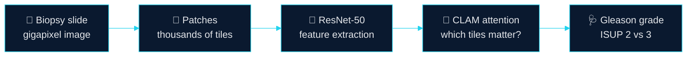

<div align="center">


<a href="https://git.io/typing-svg">
  
</a>

</div>

<br/>

```text
$ python brian.py

  ┌──────────────────────────────────────────────┐
  │  BSc Computational Biomedicine & AI          │
  │  Universidade Lusófona                       │
  │  + day job: writing code, remotely           │
  └──────────────────────────────────────────────┘

  > Goal: use AI to help medicine see more in its own data.
```

<br/>

## 🧠 `model.summary()`

If I were a neural network, this is roughly what I'd look like:

```text
Model: "Brian_v1.0"
_____________________________________________________________________
 Layer (type)                What it learns                  Status
=====================================================================
 medicine_input   (Input)    Biomedicine, biology, clinical   ✔ loaded
 python_core      (Dense)    Python · SQL · R · C             ✔ trained
 data_layer       (Dense)    Pandas · NumPy · stats           ✔ trained
 deep_learning    (Conv2D)   PyTorch · TensorFlow             ◐ training
 med_imaging      (Attn)     Pathology · MIL · CLAM           ◐ training
 biosignals       (LSTM)     ECG auditing & preparation       ◐ training
 biosensors       (Dense)    Optical & acoustic sensing       ◐ exploring
=====================================================================
 output           (Softmax)  AI researcher in medicine        ➜ loading...
_____________________________________________________________________
```

<br/>

## 🔬 What I'm building: a slide-to-diagnosis pipeline

My main project teaches a model to grade prostate cancer biopsies, aiming at the tricky **Gleason Grade 2 vs 3** boundary, using the PANDA dataset.



The idea behind Multiple Instance Learning: a slide has only one label, but thousands of patches. The model learns **where to look**, the way a pathologist does.

<br/>

## 📡 Live log

```text
[done]  Medical AI project    ->  CLAM-style MIL for Gleason grading
[run ]  Clinical ECG data     ->  auditing & preparing signals for analysis
[run ]  Fiber-optic sensing   ->  label-free biosensors & compact ultrasound probes
[run ]  Medical imaging       ->  digging deeper every week
[todo]  More projects         ->  Python · C++ · C · Linux
[todo]  Career                ->  AI/ML research & engineering
```

<br/>

<div align="center">


<br/><br/>


<br/>

[](https://linkedin.com/in/YOUR_HANDLE)
[](mailto:YOUR_EMAIL)


</div>
